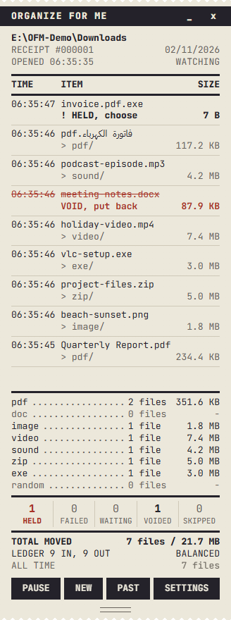
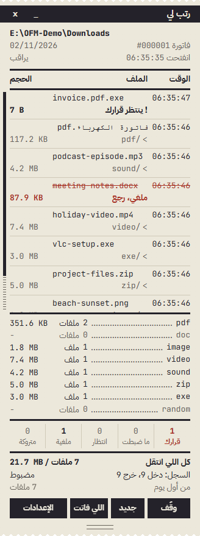
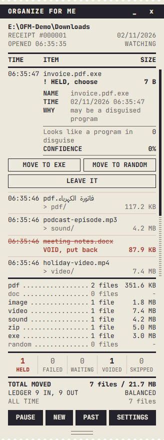
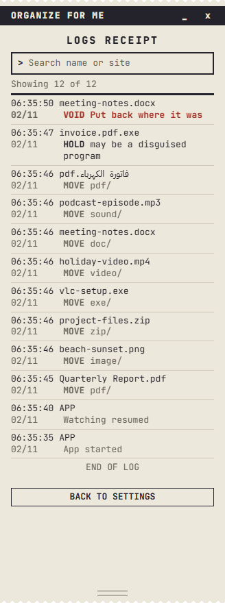
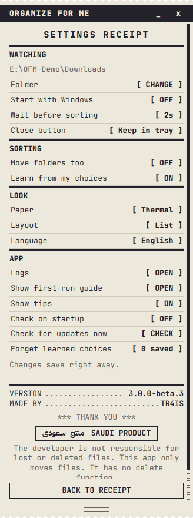
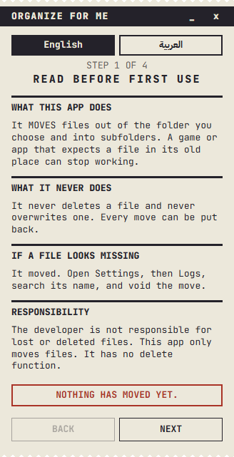
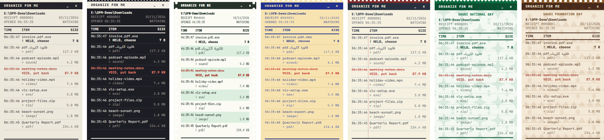

<div align="center">


# Organize for Me

### رتب لي

**Sorts your downloads into folders and prints every move on a receipt.**<br>
It never deletes a file, never overwrites one, and every move can be put back.

[](https://github.com/TR4IS/organize-for-me/releases)
[](LICENSE)
[](#install)
[](ARCHITECTURE.md)

[Download](https://github.com/TR4IS/organize-for-me/releases) · [How to use it](#how-to-use-it) · [Safety](#safety) · [Build it](#build-from-source)



</div>

> [!NOTE]
> **This is a beta, and a full rewrite of FileOrganizer in Rust.** The installer is not code
> signed yet, so Windows may warn before running it. The last Electron version remains
> available as [v2.1.0](https://github.com/TR4IS/organize-for-me/releases/tag/v2.1.0).

## Why a receipt?

An earlier version of this app moved files that people needed, and some of them lost track
of games and files. So this version was rebuilt around one idea: you should always be able
to see what happened and undo it. Each move is a line on a receipt, and the totals have to
balance.

## Screenshots

<table>
<tr>
<td align="center" width="33%"><br><b>English and Saudi Arabic</b></td>
<td align="center" width="33%"><br><b>Suspicious files wait for you</b></td>
<td align="center" width="33%"><br><b>A searchable log of every move</b></td>
</tr>
<tr>
<td align="center"><br><b>Settings</b></td>
<td align="center"><br><b>A clear guide before the first move</b></td>
<td></td>
</tr>
</table>

### Seven kinds of paper



## Features

- **Sorts by type:** PDFs, documents, images, video, sound, archives, programs and everything else
- **Only touches new files:** whatever was already in the folder stays there
- **Waits for downloads:** a file moves only once it has finished and nothing is using it
- **Undo anything:** void a move from the receipt or the log, even after a restart
- **Holds disguised programs:** a file like `invoice.pdf.exe` stays put until you decide
- **Learns from you:** remembers your choices per site, and only on your PC
- **Stays out of the way:** runs from the tray and shrinks to a small strip
- **Works offline:** no account, no ads and no telemetry

## Install

1. Download the installer from [Releases](https://github.com/TR4IS/organize-for-me/releases).
2. Run it. It needs no administrator rights. If Windows warns you, choose **More info**, then **Run anyway**.

It needs Windows 10 or 11 and Microsoft WebView2, which the installer sets up if it is missing.
It has been tested on Windows 10 so far.

## How to use it

1. Read the short guide and choose a folder. **Downloads** is the safest choice.
2. Keep working. New files move to subfolders such as `Downloads\pdf`, and each move appears on the receipt.
3. Click a line to void the move, show the file or choose where it goes.

If a file looks missing, open **Settings**, then **Logs**, search its name and put it back.

| Button | What it does |
|---|---|
| **Pause** | Stops sorting. Files that arrive during a pause stay where they are |
| **New** | Starts a clean receipt and saves the current one |
| **Past** | Shows your earlier receipts |
| **Settings** | Folder, language, paper, wait time and more |

The **X** button keeps the app running in the tray. To stop it, right-click the tray icon and choose **Quit**.

## Safety

| The app | How |
|---|---|
| Never overwrites a file | A taken name becomes `name (1)` |
| Never deletes a file | The code has no delete call for your files, and a build rule rejects one |
| Survives crashes | Each move is written to a journal before it happens |
| Waits on a full disk | Below 5 MB free, files stay put and a message explains why |
| Stays out of risky folders | System folders are blocked, and known game folders are refused |

Moving is still the app's job, so a program that expects a file in its old place can stop
working. **Never point it at a folder that holds games or installed apps.**
[SAFETY.md](SAFETY.md) lists every promise, the test behind it, and what is not promised.

## Build from source

You need Windows and [Rust](https://rustup.rs).

```bash
cargo run -p organize-for-me
```

```bash
cargo test --workspace
```

To build the installer, which lands in `target\release\bundle\nsis`:

```bash
cargo install tauri-cli --locked
```

```bash
cargo tauri build
```

## Project layout

| Folder | What is in it |
|---|---|
| `crates/ledger-core` | The decision rules. Pure logic that never touches the disk |
| `crates/ledger-platform` | The only code that touches files |
| `app` | The Tauri app: window, tray, saved state |
| `ui` | The screens, in plain HTML, CSS and JavaScript with no build step |

Read [ARCHITECTURE.md](ARCHITECTURE.md), [CONTRIBUTING.md](CONTRIBUTING.md) and [RELEASING.md](RELEASING.md) for more.

## Privacy

This program will not transfer any information to other networked systems unless
specifically requested by the user or the person installing or operating it.

The only network feature is the update check, which is off by default. When used, it asks
GitHub for the latest release and opens the release page in your browser. It never downloads
anything by itself, and [GitHub's privacy statement](https://docs.github.com/site-policy/privacy-policies/github-general-privacy-statement)
applies to that request. The installer may download Microsoft WebView2 if your PC does not have it.

## Code signing policy

Releases are not signed yet. An application for free signing through SignPath is planned.
Once it is accepted, this section will carry the required credit, and each signed release
will be built from this repository and approved by hand.

- Committers and reviewers: [TR4IS](https://github.com/TR4IS)
- Approvers: [TR4IS](https://github.com/TR4IS)

## License and credits

[MIT](LICENSE), provided without warranty. Third-party notices are in
[THIRD-PARTY-LICENSES.html](THIRD-PARTY-LICENSES.html), and the installer includes them.
The bundled fonts, Courier Prime, IBM Plex Sans Arabic, JetBrains Mono and VT323, use the
[SIL Open Font License](ui/fonts).

Built with [Tauri](https://tauri.app). AI tools were used to help build this app.
Thanks to everyone who used and contributed to versions 1 and 2.
